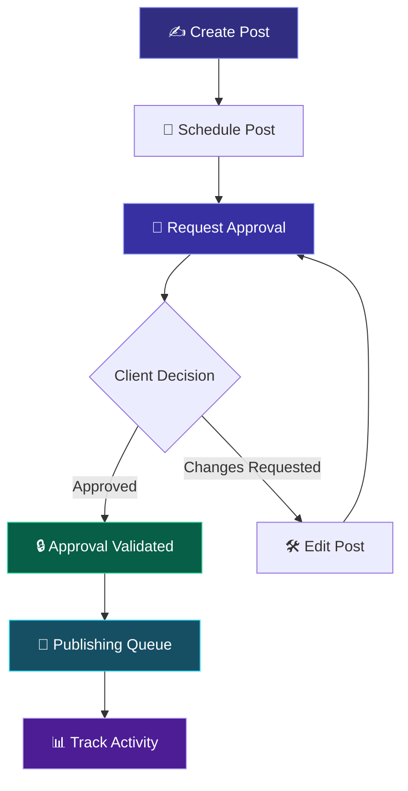

# 🚀 SocialBuzz

<p align="center">
  
</p>

<p align="center">
  <strong>A modern social media management platform for agencies.</strong><br/>
  Manage clients, plan content, streamline approvals and track publishing from one beautiful dashboard.
</p>

<p align="center">
  
  
  
  
  
</p>

<p align="center">
  <a href="#-overview">Overview</a> •
  <a href="#-features">Features</a> •
  <a href="#-demo">Demo</a> •
  <a href="#-installation">Installation</a> •
  <a href="#-roadmap">Roadmap</a>
</p>

---

## ✨ Overview

**SocialBuzz** is a modern, interactive social media management platform designed to simplify the workflow of digital marketing agencies.

Managing multiple clients, creating content, tracking approvals and scheduling posts across different platforms can quickly become complicated. SocialBuzz brings these activities together in one centralized workspace.

With an intuitive interface, animated interactions, a visual content calendar and an approval-based workflow, SocialBuzz demonstrates how agencies can organize their social media operations efficiently.

> **Our vision:** Make social media management simpler, more transparent and more organized.

## 🎬 Demo

<p align="center">
  <!-- Replace with your actual demo GIF -->
  
</p>

<p align="center">
  <em>Replace the placeholder above with a screen recording or animated GIF of your application.</em>
</p>

**Live Preview:** [Add your deployed application URL here](#)

## 🌟 Features

<table>
  <tr>
    <td width="50%">
      <h3>📊 Smart Dashboard</h3>
      Get an overview of clients, scheduled posts, pending approvals and publishing activity.
    </td>
    <td width="50%">
      <h3>📅 Content Calendar</h3>
      Organize and visualize upcoming social media posts through a calendar interface.
    </td>
  </tr>
  <tr>
    <td width="50%">
      <h3>✍️ Post Composer</h3>
      Create posts, write captions, select clients and schedule content.
    </td>
    <td width="50%">
      <h3>✅ Client Approvals</h3>
      Manage approval requests and handle changes before a post is published.
    </td>
  </tr>
  <tr>
    <td width="50%">
      <h3>🚀 Publishing Queue</h3>
      View approved posts and simulate publishing, including success and failure states.
    </td>
    <td width="50%">
      <h3>📈 Analytics</h3>
      Explore charts and reports that demonstrate content performance tracking.
    </td>
  </tr>
  <tr>
    <td width="50%">
      <h3>👥 Client Management</h3>
      Organize client profiles and review their associated content.
    </td>
    <td width="50%">
      <h3>🔔 Notifications & Audit Logs</h3>
      Track important updates and maintain a history of simulated activities.
    </td>
  </tr>
</table>

## 🔄 How It Works



The approval workflow is central to SocialBuzz. Posts must receive valid approval before proceeding through the publishing workflow. Editing an approved post requires approval again.

## 🖥️ Application Screenshots

<p align="center">
  
  <br/><em>Dashboard — an overview of agency activities.</em>
</p>

<p align="center">
  
  <br/><em>Content Calendar — visual content planning.</em>
</p>

<p align="center">
  
  <br/><em>Approvals — review and manage client decisions.</em>
</p>

<p align="center">
  <em>Add screenshots from your actual application to replace these placeholders.</em>
</p>

## 🛠️ Tech Stack

| Technology | Purpose |
|---|---|
| React | Component-based frontend |
| Vite | Development server and build tooling |
| TypeScript | Type-safe application code, if enabled |
| Tailwind CSS | Utility-based styling, if used in the project |
| Framer Motion | Animations and transitions |
| React Router | Client-side navigation |
| Recharts | Interactive analytics charts |
| Lucide React | Icons |
| Local Storage | Persistence of demo data |

*The table should reflect the packages actually installed in your repository.*

## 📂 Project Structure

```text
socialbuzz/
├── public/
├── src/
│   ├── assets/
│   ├── components/
│   │   ├── common/
│   │   ├── dashboard/
│   │   ├── calendar/
│   │   └── approvals/
│   ├── pages/
│   ├── layouts/
│   ├── data/
│   ├── hooks/
│   ├── routes/
│   ├── services/
│   ├── types/
│   ├── utils/
│   ├── App.tsx
│   └── main.tsx
├── docs/
│   └── assets/
├── package.json
└── README.md
```

*This is a suggested structure; adjust it to match your actual project.*

## ⚙️ Installation

### Prerequisites

- Node.js (LTS recommended)
- npm
- Git

### 1. Clone the repository

```bash
git clone https://github.com/YOUR_USERNAME/SocialBuzz.git
cd SocialBuzz
```

### 2. Install dependencies

```bash
npm install
```

### 3. Start the development server

```bash
npm run dev
```

Open the local URL printed by Vite in your terminal, usually `http://localhost:5173`.

### 4. Create a production build

```bash
npm run build
```

### 5. Preview the production build

```bash
npm run preview
```

## 🧪 Demo Mode

SocialBuzz currently demonstrates its primary workflows using sample data.

- Sample clients and posts
- Interactive post creation and scheduling
- Simulated approval and publishing
- Demo analytics and activity history
- Local storage for supported persistent state

**Note:** Publishing is simulated. The current prototype does not claim to publish directly to Instagram, Facebook, LinkedIn or other social media platforms.

## 🎨 Design Philosophy

SocialBuzz uses a modern SaaS-inspired interface focused on clarity and usability.

- Dark, premium visual direction
- Midnight-inspired backgrounds with electric accents
- Animated transitions and micro-interactions
- Responsive layouts for desktop, tablet and mobile
- Reusable UI components
- Clear content and approval states

## 🗺️ Roadmap

- [x] Responsive frontend prototype
- [x] Interactive dashboard
- [x] Content calendar and composer
- [x] Approval workflow
- [x] Simulated publishing queue
- [x] Demo analytics
- [ ] Backend API integration
- [ ] Database integration
- [ ] Secure authentication and role-based access
- [ ] Official social media API integrations
- [ ] Real-time notifications
- [ ] Advanced analytics and reporting

## 🔐 Security & Approval

SocialBuzz demonstrates an approval-gated publishing workflow. A production deployment would additionally require server-side approval validation, authentication, authorization and secure storage of credentials.

## 👨‍💻 Author

<p align="center">
  <strong>Atharva Gahine</strong><br/>
  B.Tech — Computer Science & Engineering<br/>
  ITM Skills University<br/>
  Course: Software Engineering & Project Management<br/>
  Roll No: 150096724079<br/>
  Case Study: No. 119
</p>

<p align="center">
  <a href="https://github.com/AtharvaGahine11">
    
  </a>
</p>

## 📄 License

This project is developed as an academic project. A license can be added if you intend to distribute or reuse the source code.

---

<p align="center">
  <strong>SocialBuzz</strong><br/>
  <em>Plan smarter. Collaborate better. Publish with confidence.</em><br/><br/>
  Made with ❤️ by Atharva Gahine
</p>
